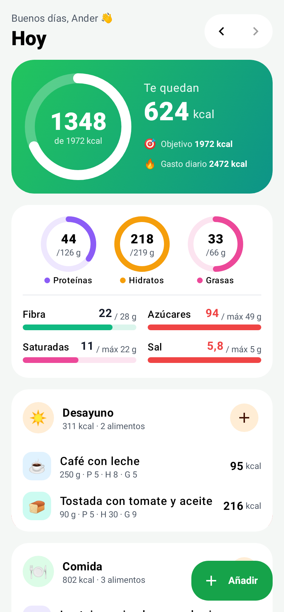
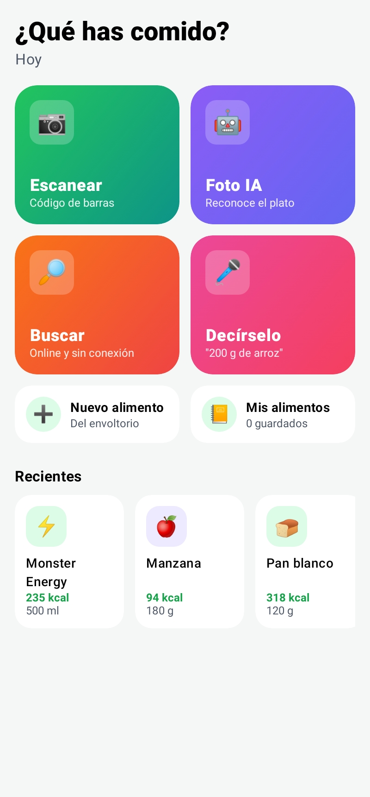
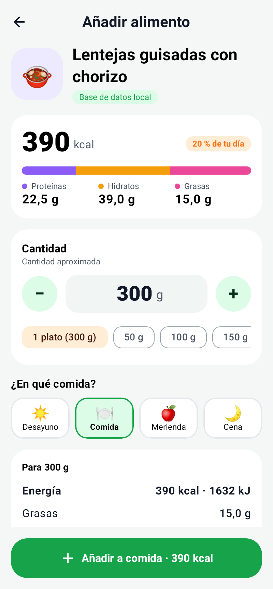
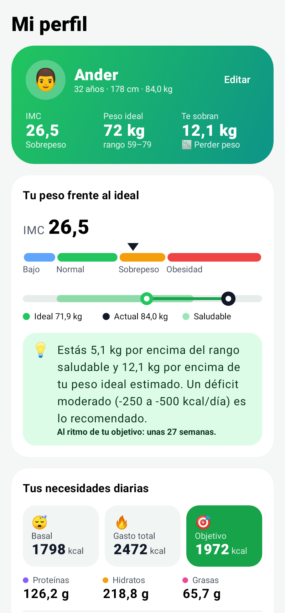

# NutriDiario

**Descargar la app:** [apk/NutriDiario.apk](https://github.com/origamieder/NutriDiario/raw/main/apk/NutriDiario.apk) (Android 8 o superior; acepta instalar apps de origen desconocido).

App Android (Kotlin + Jetpack Compose) para registrar lo que comes y calcular calorías y nutrientes.

 
 

## Formas de añadir comida
- **Código de barras**: cámara + ML Kit (modelo incluido en la app) → datos de Open Food Facts (requiere internet).
  Con «Añadir al instante» se apunta solo con la cantidad del envase y puedes escanear varios seguidos.
- **Mis alimentos**: productos guardados con los datos del envoltorio (y su código de barras, funciona sin internet).
  Los valores se rellenan solos haciendo una foto a la tabla nutricional (OCR de ML Kit en el móvil).
- **Búsqueda**: base local de unos 160 alimentos genéricos (sin conexión) + productos de Open Food Facts (online).
- **Foto con IA local** (sin internet, dentro del APK): un modelo de **101 platos** (Food-101: paella, tortilla, carbonara,
  churros, ensaladas, tartas…; 94 % de acierto entre sus 5 primeras propuestas) y otro general para fruta, verdura y
  bebidas. Detalles en `tools/convert_food101.md`. Tú confirmas y ajustas los gramos.
- **Decírselo**: texto o voz, p. ej. "150 g de pollo", "2 huevos", "un vaso de leche".
- **Crear alimento**: copiando los valores de la etiqueta nutricional (por 100 g o por ración).

## Recetas
Dime qué ingredientes tienes (escrito, por voz o tocando) y propone platos de **1 ración**:
los que puedes hacer ya y los que casi tienes. 48 recetas caseras con calorías y macros calculados
por ingrediente, pasos, lista de la compra y, para cada ingrediente, foto de producto de marca
Eroski (Open Food Facts) y botón para buscarlo en supermercado.eroski.es. Las recetas se generan con
`tools/gen_recipes.py` a partir de `tools/recipes.txt`.

## Perfil
Sexo, edad, altura, peso, actividad y objetivo → IMC, rango de peso saludable, peso ideal (Devine, Robinson,
Miller, Hamwi, IMC 22), grasa corporal estimada, metabolismo basal (Mifflin-St Jeor), gasto diario,
objetivo calórico y de macronutrientes. Pestaña "Progreso" con gráfica de peso y calorías.

Los datos se guardan solo en el móvil.

## Capturas de pantalla
`./gradlew testDebugUnitTest --tests '*Screenshots*'` genera capturas en `app/build/screens/` (Robolectric, sin emulador).

## Compilar
Requisitos: JDK 17+ y Android SDK (platform 35). `./gradlew assembleRelease` →
`app/build/outputs/apk/release/app-release.apk`.
